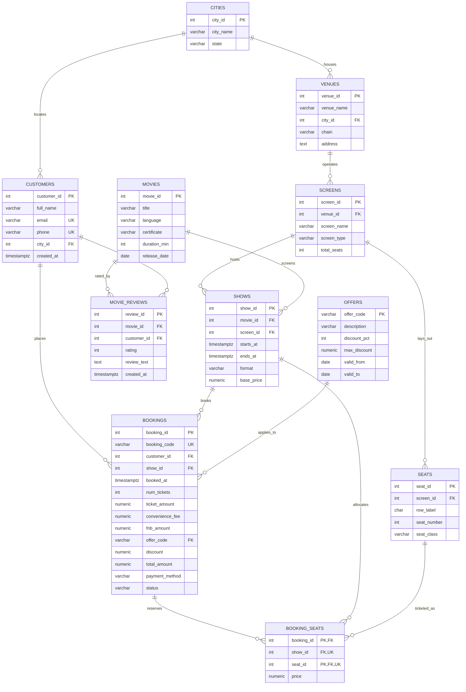

# Phase 2: Relational Schema Design & Data Architecture Report

**Project:** BookMyShow Movie & Event Ticketing Database (DBMS Project 2026)  
**Schema Name:** `bms`  
**Target RDBMS:** PostgreSQL 15+  
**Team Number:** T0012  

---

## 1. Executive Summary & Design Principles

The objective of Phase 2 is to architect a production-grade relational schema in PostgreSQL derived directly from the production seed exports (spanning 11 entities, 300,389 booking seat records, and 160,034 shows).

### Core Architectural Decisions
1. **Schema Encapsulation:** All relational objects are housed inside the dedicated namespace `bms` (`CREATE SCHEMA bms; SET search_path TO bms;`).
2. **Domain-Specific Typing:** Replaced generic text storage with exact data types:
   - Currency and monetary sums use `NUMERIC(10, 2)` to eliminate IEEE 754 floating-point rounding errors.
   - Timestamps incorporate explicit offsets using `TIMESTAMPTZ` (`TIMESTAMP WITH TIME ZONE`) to ensure multi-region consistency across Indian Standard Time (`+05:30`).
   - Dates without time components use `DATE`.
   - Small ranges and enumeration attributes use constrained `VARCHAR` or `INT` with strict domain `CHECK` constraints.
3. **Strict Relational Constraints Only:** In accordance with Phase 2 rules, only fundamental relational constraints are created (**Primary Keys, Foreign Keys, Unique Keys, Check Constraints, and Exclusion Constraints**). No auxiliary secondary indexes are created in this phase, establishing an un-tuned baseline for Phase 3.
4. **Declarative Invariant Enforcement:** Critical business invariants—preventing double booking of auditorium seats and preventing overlapping show schedules on the same screen—are guaranteed declaratively at the storage engine level.

---

## 2. Entity-Relationship (ER) Diagram



---

## 3. Comprehensive Data Dictionary

### Table 1: `cities` (10 rows)
Represents geographic municipal locations where cinemas operate.
| Column | PostgreSQL Type | Nullable | Constraints | Semantic Description & Justification |
|---|---|---|---|---|
| `city_id` | `INT` | No | `PRIMARY KEY` | Unique municipal identifier. |
| `city_name` | `VARCHAR(100)` | No | `NOT NULL`, `UNIQUE` | City name (e.g., Bengaluru, Mumbai). |
| `state` | `VARCHAR(100)` | No | `NOT NULL` | State jurisdiction (e.g., Karnataka, Maharashtra). |

### Table 2: `venues` (140 rows)
Represents physical cinema properties/complexes.
| Column | PostgreSQL Type | Nullable | Constraints | Semantic Description & Justification |
|---|---|---|---|---|
| `venue_id` | `INT` | No | `PRIMARY KEY` | Unique cinema venue identifier. |
| `venue_name` | `VARCHAR(150)` | No | `NOT NULL` | Registered property name (e.g., PVR Forum Mumbai). |
| `city_id` | `INT` | No | `NOT NULL`, `FK -> cities(city_id) ON DELETE RESTRICT` | City location. Restrict prevents deleting cities with active venues. |
| `chain` | `VARCHAR(50)` | No | `NOT NULL`, `CHECK (chain IN ('Cinepolis', 'INOX', 'Independent', 'Miraj', 'PVR'))` | Commercial operating brand. |
| `address` | `TEXT` | No | `NOT NULL` | Street address of the complex. |

### Table 3: `screens` (490 rows)
Represents individual auditoriums inside a cinema complex.
| Column | PostgreSQL Type | Nullable | Constraints | Semantic Description & Justification |
|---|---|---|---|---|
| `screen_id` | `INT` | No | `PRIMARY KEY` | Unique auditorium identifier. |
| `venue_id` | `INT` | No | `NOT NULL`, `FK -> venues(venue_id) ON DELETE CASCADE` | Parent cinema. Cascade deletes screens if a venue is demolished. |
| `screen_name` | `VARCHAR(50)` | No | `NOT NULL` | Human-readable name (e.g., Audi 1, Audi 2). |
| `screen_type` | `VARCHAR(20)` | No | `NOT NULL`, `CHECK (screen_type IN ('4DX', 'GOLD', 'IMAX', 'STANDARD'))` | Projection/experience tier. |
| `total_seats` | `INT` | No | `NOT NULL`, `CHECK (total_seats > 0 AND total_seats <= 1000)` | Physical auditorium capacity (denormalized cache). |

### Table 4: `seats` (94,056 rows)
Represents individual physical seat units in an auditorium.
| Column | PostgreSQL Type | Nullable | Constraints | Semantic Description & Justification |
|---|---|---|---|---|
| `seat_id` | `INT` | No | `PRIMARY KEY` | Unique physical seat identifier across the system. |
| `screen_id` | `INT` | No | `NOT NULL`, `FK -> screens(screen_id) ON DELETE CASCADE` | Auditorium location. |
| `row_label` | `VARCHAR(2)` | No | `NOT NULL`, `CHECK (row_label ~ '^[A-P]$')` | Alphabetical row identifier (A through P in seed data). |
| `seat_number` | `INT` | No | `NOT NULL`, `CHECK (seat_number > 0 AND seat_number <= 100)` | Numerical position within the row. |
| `seat_class` | `VARCHAR(20)` | No | `NOT NULL`, `CHECK (seat_class IN ('CLASSIC', 'PRIME', 'RECLINER'))` | Seating category determining base pricing. |
| *Composite* | — | — | `UNIQUE (screen_id, row_label, seat_number)` | **Natural Key:** Prohibits duplicate seat labels within the same auditorium. |

### Table 5: `movies` (300 rows)
Represents films scheduled for theatrical screening.
| Column | PostgreSQL Type | Nullable | Constraints | Semantic Description & Justification |
|---|---|---|---|---|
| `movie_id` | `INT` | No | `PRIMARY KEY` | Unique film title identifier. |
| `title` | `VARCHAR(255)` | No | `NOT NULL` | Official movie release title. |
| `language` | `VARCHAR(50)` | No | `NOT NULL` | Primary spoken audio track (e.g., Hindi, Telugu, Tamil). |
| `certificate` | `VARCHAR(10)` | No | `NOT NULL`, `CHECK (certificate IN ('A', 'U', 'UA'))` | CBFC statutory rating certificate. |
| `duration_min` | `INT` | No | `NOT NULL`, `CHECK (duration_min > 0 AND duration_min <= 400)` | Runtime duration in minutes. |
| `release_date` | `DATE` | No | `NOT NULL` | Commercial theatrical release date. |

### Table 6: `shows` (160,034 rows)
Represents scheduled movie screenings in a specific auditorium.
| Column | PostgreSQL Type | Nullable | Constraints | Semantic Description & Justification |
|---|---|---|---|---|
| `show_id` | `INT` | No | `PRIMARY KEY` | Unique screening identifier. |
| `movie_id` | `INT` | No | `NOT NULL`, `FK -> movies(movie_id) ON DELETE RESTRICT` | Film being screened. Restrict prevents deleting movies with active shows. |
| `screen_id` | `INT` | No | `NOT NULL`, `FK -> screens(screen_id) ON DELETE RESTRICT` | Auditorium being booked. |
| `starts_at` | `TIMESTAMPTZ` | No | `NOT NULL` | Scheduled showtime commencement with time-zone. |
| `ends_at` | `TIMESTAMPTZ` | No | `NOT NULL`, `CHECK (starts_at < ends_at)` | Scheduled showtime completion. |
| `format` | `VARCHAR(20)` | No | `NOT NULL`, `CHECK (format IN ('2D', '3D', '4DX', 'IMAX'))` | Projection format. |
| `base_price` | `NUMERIC(10, 2)` | No | `NOT NULL`, `CHECK (base_price >= 0)` | Base ticket price before category multipliers. |
| *Exclusion* | — | — | `EXCLUDE USING gist (screen_id WITH =, tsrange(starts_at, ends_at) WITH &&)` | **Non-Overlap Invariant:** Prohibits two shows overlapping on the same screen. |

### Table 7: `customers` (40,000 rows)
Represents registered platform end-users.
| Column | PostgreSQL Type | Nullable | Constraints | Semantic Description & Justification |
|---|---|---|---|---|
| `customer_id` | `INT` | No | `PRIMARY KEY` | Unique user account identifier. |
| `full_name` | `VARCHAR(150)` | No | `NOT NULL` | Customer's full name. |
| `email` | `VARCHAR(255)` | No | `NOT NULL`, `UNIQUE` | Email address (natural login identifier). |
| `phone` | `VARCHAR(15)` | No | `NOT NULL`, `UNIQUE`, `CHECK (phone ~ '^[0-9]{10}$')` | 10-digit mobile number for OTP sign-in (`R23`). |
| `city_id` | `INT` | No | `NOT NULL`, `FK -> cities(city_id) ON DELETE RESTRICT` | Home city location. |
| `created_at` | `TIMESTAMPTZ` | No | `NOT NULL` | Account registration timestamp. |

### Table 8: `offers` (25 rows)
Represents promotional partner vouchers and discount schemes.
| Column | PostgreSQL Type | Nullable | Constraints | Semantic Description & Justification |
|---|---|---|---|---|
| `offer_code` | `VARCHAR(50)` | No | `PRIMARY KEY` | Alphanumeric coupon redemption code. |
| `description` | `VARCHAR(255)` | No | `NOT NULL` | Promotion summary terms. |
| `discount_pct` | `INT` | No | `NOT NULL`, `CHECK (discount_pct > 0 AND discount_pct <= 100)` | Percentage reduction applied to ticket amounts. |
| `max_discount` | `NUMERIC(10, 2)` | No | `NOT NULL`, `CHECK (max_discount >= 0)` | Maximum currency cap on discount. |
| `valid_from` | `DATE` | No | `NOT NULL` | Campaign start date. |
| `valid_to` | `DATE` | No | `NOT NULL`, `CHECK (valid_from <= valid_to)` | Campaign expiration date. |

### Table 9: `bookings` (150,094 rows)
Represents financial checkout transactions.
| Column | PostgreSQL Type | Nullable | Constraints | Semantic Description & Justification |
|---|---|---|---|---|
| `booking_id` | `INT` | No | `PRIMARY KEY` | Internal transactional primary key. |
| `booking_code` | `VARCHAR(20)` | No | `NOT NULL`, `UNIQUE`, `CHECK (booking_code ~ '^BMS[0-9A-F]{7}$')` | Alphanumeric reservation code used by customer support (`R04`). |
| `customer_id` | `INT` | No | `NOT NULL`, `FK -> customers(customer_id) ON DELETE RESTRICT` | Purchasing customer account. |
| `show_id` | `INT` | No | `NOT NULL`, `FK -> shows(show_id) ON DELETE RESTRICT` | Reserved screening. |
| `booked_at` | `TIMESTAMPTZ` | No | `NOT NULL` | Timestamp of reservation creation. |
| `num_tickets` | `INT` | No | `NOT NULL`, `CHECK (num_tickets > 0)` | Number of seats reserved in transaction. |
| `ticket_amount` | `NUMERIC(10, 2)` | No | `NOT NULL`, `CHECK (ticket_amount >= 0)` | Sum of seat ticket prices. |
| `convenience_fee`| `NUMERIC(10, 2)` | No | `NOT NULL`, `CHECK (convenience_fee >= 0)` | Online processing fee (typically 10% of ticket amount). |
| `fnb_amount` | `NUMERIC(10, 2)` | No | `NOT NULL`, `CHECK (fnb_amount >= 0)` | Food & beverage total. |
| `offer_code` | `VARCHAR(50)` | **Yes** | `FK -> offers(offer_code) ON DELETE SET NULL` | Applied discount voucher. Empty when booking without discounts. |
| `discount` | `NUMERIC(10, 2)` | No | `NOT NULL`, `CHECK (discount >= 0)` | Applied discount currency amount. |
| `total_amount` | `NUMERIC(10, 2)` | No | `NOT NULL`, `CHECK (total_amount >= 0)` | Grand total billed to customer. |
| `payment_method`| `VARCHAR(30)` | No | `NOT NULL`, `CHECK (payment_method IN ('CARD', 'GIFT_CARD', 'NETBANKING', 'UPI', 'WALLET'))` | Settlement channel. |
| `status` | `VARCHAR(30)` | No | `NOT NULL`, `CHECK (status IN ('CANCELLED', 'CONFIRMED', 'PAYMENT_FAILED', 'PENDING'))` | Lifecycle state of reservation. |
| *Balance Rule* | — | — | `CHECK (total_amount = ticket_amount + convenience_fee + fnb_amount - discount)` | **Integrity Check:** Guarantees arithmetic invoice consistency. |

### Table 10: `booking_seats` (300,389 rows)
Represents seat inventory reserved under a booking.
| Column | PostgreSQL Type | Nullable | Constraints | Semantic Description & Justification |
|---|---|---|---|---|
| `booking_id` | `INT` | No | `NOT NULL`, `FK -> bookings(booking_id) ON DELETE CASCADE` | Associated checkout. Cascade purges seats when booking is deleted. |
| `show_id` | `INT` | No | `NOT NULL`, `FK -> shows(show_id) ON DELETE RESTRICT` | Redundant foreign key providing direct indexing for layout availability (`R03`). |
| `seat_id` | `INT` | No | `NOT NULL`, `FK -> seats(seat_id) ON DELETE RESTRICT` | Specific physical seat. |
| `price` | `NUMERIC(10, 2)` | No | `NOT NULL`, `CHECK (price >= 0)` | Price charged for this individual seat. |
| *Primary Key* | — | — | `PRIMARY KEY (booking_id, seat_id)` | Compound primary key uniquely identifying a seat in a checkout. |
| *Uniqueness* | — | — | `UNIQUE (show_id, seat_id)` | **Anti-Double-Booking Invariant:** Prohibits selling the same seat twice for one show. |

### Table 11: `movie_reviews` (32,510 rows)
Represents user ratings and critical reviews for released films.
| Column | PostgreSQL Type | Nullable | Constraints | Semantic Description & Justification |
|---|---|---|---|---|
| `review_id` | `INT` | No | `PRIMARY KEY` | Unique review identifier. |
| `movie_id` | `INT` | No | `NOT NULL`, `FK -> movies(movie_id) ON DELETE CASCADE` | Reviewed movie. Cascade deletes reviews if movie is purged. |
| `customer_id` | `INT` | No | `NOT NULL`, `FK -> customers(customer_id) ON DELETE CASCADE` | Author customer. |
| `rating` | `INT` | No | `NOT NULL`, `CHECK (rating >= 1 AND rating <= 10)` | Numeric rating scale from 1 (poor) to 10 (masterpiece). |
| `review_text` | `TEXT` | **Yes** | None | Optional text review commentary. Nullable when user provides a star rating only. |
| `created_at` | `TIMESTAMPTZ` | No | `NOT NULL` | Submission timestamp. |
| *Uniqueness* | — | — | `UNIQUE (movie_id, customer_id)` | Guarantees at most one review per customer per movie. |

---

## 4. Normalization Analysis (1NF through BCNF)

### Functional Dependencies (FDs) by Relation
1. **`cities`**: `city_id -> city_name, state` (Candidate Key: `{city_id}`).
2. **`venues`**: `venue_id -> venue_name, city_id, chain, address` (Candidate Key: `{venue_id}`).
3. **`screens`**: `screen_id -> venue_id, screen_name, screen_type, total_seats` (Candidate Key: `{screen_id}`).
4. **`seats`**: `seat_id -> screen_id, row_label, seat_number, seat_class` AND `{screen_id, row_label, seat_number} -> seat_id, seat_class` (Candidate Keys: `{seat_id}`, `{screen_id, row_label, seat_number}`).
5. **`movies`**: `movie_id -> title, language, certificate, duration_min, release_date` (Candidate Key: `{movie_id}`).
6. **`shows`**: `show_id -> movie_id, screen_id, starts_at, ends_at, format, base_price` (Candidate Key: `{show_id}`).
7. **`customers`**: `customer_id -> full_name, email, phone, city_id, created_at` AND `email -> customer_id, ...` AND `phone -> customer_id, ...` (Candidate Keys: `{customer_id}`, `{email}`, `{phone}`).
8. **`offers`**: `offer_code -> description, discount_pct, max_discount, valid_from, valid_to` (Candidate Key: `{offer_code}`).
9. **`bookings`**: `booking_id -> booking_code, customer_id, show_id, booked_at, num_tickets, ticket_amount, convenience_fee, fnb_amount, offer_code, discount, total_amount, payment_method, status` AND `booking_code -> booking_id, ...` (Candidate Keys: `{booking_id}`, `{booking_code}`).
10. **`booking_seats`**: `{booking_id, seat_id} -> show_id, price` AND `{show_id, seat_id} -> booking_id, price` (Candidate Keys: `{booking_id, seat_id}`, `{show_id, seat_id}`).
11. **`movie_reviews`**: `review_id -> movie_id, customer_id, rating, review_text, created_at` AND `{movie_id, customer_id} -> review_id, rating, review_text, created_at` (Candidate Keys: `{review_id}`, `{movie_id, customer_id}`).

### Normal Form Evaluation
- **1NF Compliance:** All attributes are atomic (scalar values). No multi-valued repeating groups or comma-separated lists exist.
- **2NF Compliance:** Every non-prime attribute is fully functionally dependent on the entire candidate key. No partial dependencies exist on compound keys.
- **3NF & BCNF Compliance:** For every non-trivial functional dependency $X \rightarrow Y$, the determinant $X$ is a superkey. Therefore, the core schema strictly satisfies **Boyce-Codd Normal Form (BCNF)**.

### Analysis of Deliberately Denormalized / Redundant Attributes

While the logical model adheres to BCNF, four specific attributes contain calculated or transitive redundancies that are critically justified for high-scale enterprise operations:

| Entity & Attribute | Redundant With | Technical & Business Justification for Retention |
|---|---|---|
| `screens.total_seats` | `COUNT(seats.seat_id)` | **Eliminates High-Frequency Aggregate Joins:** During seat search and cinema dashboards (`R07`, `R25`), reading `screens.total_seats` avoids scanning and aggregating tens of thousands of rows from `seats` for every catalog request. |
| `bookings.ticket_amount` | `SUM(booking_seats.price)` | **Financial Auditability & Mutation Safety:** Preserves the transactional balance sheet. When bookings are cancelled or expire (`W04`), rows in `booking_seats` are deleted, yet `ticket_amount` in `bookings` must persist permanently to track historical gross bookings and cancellation ratios (`R16`). |
| `booking_seats.show_id` | `bookings.show_id` | **Enforces Declarative Double-Booking Invariant:** Having `show_id` directly in `booking_seats` allows PostgreSQL to enforce the engine-level constraint `UNIQUE (show_id, seat_id)`. Without it, preventing double booking would require cross-table triggers, destroying write throughput on `W01`/`W02`. Furthermore, it accelerates layout rendering (`R03`) without an extra table join. |
| `shows.ends_at` | `shows.starts_at + movies.duration_min` | **Enables GiST Temporal Indexing & Scheduling Gap Verification:** Essential for the `EXCLUDE USING gist` constraint to prevent showtime collisions. It also allows simple interval math (`s2.starts_at - s1.ends_at`) for cleaning gap audits (`R10`) without dynamically recalculating durations from joined movie rows. |

---

## 5. Declarative Invariant Enforcement

### 1. Preventing Duplicate Seat Bookings (Double Allocation)
In cinema ticketing, the most catastrophic failure is selling the same auditorium seat to two different customers for the same show.
- **Enforcement Mechanism:** The compound constraint `UNIQUE (show_id, seat_id)` on `booking_seats`.
- **Database Engine Operation:** PostgreSQL enforces this constraint via a unique B-tree index. When transaction $T_1$ inserts `(show_id=144446, seat_id=31535)`, it acquires an exclusive tuple lock. If a concurrent transaction $T_2$ attempts to insert the identical pair, PostgreSQL detects the key conflict in the index leaf page, aborting $T_2$ with a `unique_violation` (`SQLSTATE 23505`).
- **Cancellation Behavior:** When a booking is cancelled or payment fails, its rows in `booking_seats` are deleted. This atomically frees the `(show_id, seat_id)` pair in the index, allowing subsequent transactions to book the seat without race conditions.

### 2. Preventing Overlapping Shows on the Same Screen
A cinema auditorium cannot physically project two films simultaneously.
- **Enforcement Mechanism:** PostgreSQL **Exclusion Constraint** utilizing the `btree_gist` extension:
  ```sql
  CREATE EXTENSION IF NOT EXISTS btree_gist;

  ALTER TABLE shows ADD CONSTRAINT no_overlapping_shows
    EXCLUDE USING gist (
      screen_id WITH =,
      tsrange(starts_at, ends_at) WITH &&
    );
  ```
- **Database Engine Operation:** A standard `CHECK` constraint can only evaluate values within a single tuple. To enforce constraints across multiple rows, PostgreSQL uses Generalized Search Tree (GiST) indexing over range types (`tsrange`).
- The condition `screen_id WITH =` matches shows sharing the same auditorium.
- The condition `tsrange(starts_at, ends_at) WITH &&` detects temporal overlap (`&&` range intersection).
- Any attempt to insert or reschedule a show that intersects an existing screening on the same screen is rejected at the engine level (`exclusion_violation`, `SQLSTATE 23P01`).

---

## 6. Seed Data Integrity Audit & Verification Results

A comprehensive verification script was executed against all 11 seed CSV exports to confirm that our declarative constraints accept 100% of the production data without errors.

```
┌────────────────────────────────────────────────────────────────────────────┐
│                        Seed Data Verification Log                          │
├─────────────────────────────────────────────────┬──────────────────────────┤
│ Integrity Verification Check                    │ Result                   │
├─────────────────────────────────────────────────┼──────────────────────────┤
│ 1. Booked seats belong to the show's screen     │ 0 Mismatches (100% Valid)│
│ 2. Active bookings ticket count vs seats count  │ 0 Mismatches (100% Valid)│
│ 3. Overlapping shows on identical screen        │ 0 Overlaps (100% Valid)  │
│ 4. Total amount formula balance (bookings.csv)  │ 0 Errors (100% Valid)    │
│ 5. Booking code format regex (^BMS[0-9A-F]{7}$) │ 0 Invalid (100% Valid)   │
│ 6. Seat row labels domain ([A-P])               │ 0 Invalid (100% Valid)   │
│ 7. Customer phone regex (10 digits)             │ 0 Invalid (100% Valid)   │
│ 8. Review rating domain ([1-10])                │ 0 Invalid (100% Valid)   │
└─────────────────────────────────────────────────┴──────────────────────────┘
```

### Table Row Counts Confirmed
- `cities`: 10 rows
- `venues`: 140 rows
- `screens`: 490 rows
- `seats`: 94,056 rows
- `movies`: 300 rows
- `shows`: 160,034 rows
- `customers`: 40,000 rows
- `offers`: 25 rows
- `bookings`: 150,094 rows
- `booking_seats`: 300,389 rows
- `movie_reviews`: 32,510 rows

### Data Findings & Nullability Profile
- Across the entire production dataset, **only two columns contain NULL values**:
  1. `bookings.offer_code` (127,659 nulls): Natural omission when customers checkout without promotional coupons.
  2. `movie_reviews.review_text` (16,162 nulls): Natural omission when customers provide star ratings without textual reviews.
- All other attributes across all 11 tables are strictly `NOT NULL`.
- In `bookings`, all 8,910 `CANCELLED` and 7,606 `PAYMENT_FAILED` records have 0 associated rows in `booking_seats`, verifying that cancelled/failed reservations correctly release their seat locks back into available inventory.
