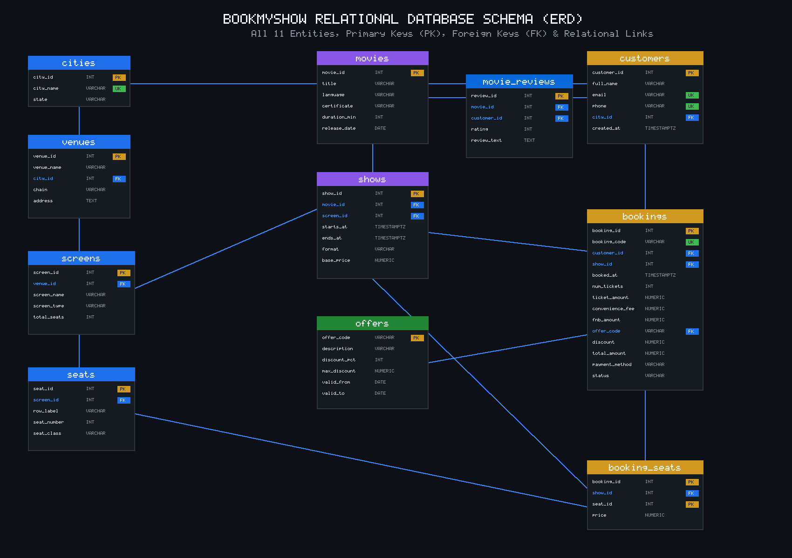

# Schema Design (Phase 2)

Database: PostgreSQL 16, schema `bms`. All 11 tables load cleanly from `seed_data/` with the row counts from the project brief. Files: `sql/01_schema.sql`, `sql/02_load_data.sql`.

## 1. ER diagram

Mermaid source: `diagrams/er_diagram.mmd`.

Cardinalities: city 1:N venues, city 1:N customers; venue 1:N screens; screen 1:N seats and 1:N shows; movie 1:N shows and 1:N reviews; customer 1:N bookings and 1:N reviews; show 1:N bookings; offer 0..1:N bookings; booking 1:N booking_seats. `booking_seats` is the link between bookings and seats (M:N through shows).

## 2. Data dictionary

### cities
| Column | Type | Constraint | Why |
|---|---|---|---|
| city_id | integer | PK | surrogate key from the export |
| city_name | text | NOT NULL, UNIQUE | natural candidate key |
| state | text | NOT NULL | every city belongs to a state |

### venues
| Column | Type | Constraint | Why |
|---|---|---|---|
| venue_id | integer | PK | |
| venue_name | text | NOT NULL | |
| city_id | integer | NOT NULL, FK cities, ON DELETE RESTRICT | a cinema must have a city; do not delete a city that still has cinemas |
| chain | text | NOT NULL, CHECK in (Cinepolis, Independent, INOX, Miraj, PVR) | list taken from `SELECT DISTINCT` |
| address | text | NOT NULL | |

### screens
| Column | Type | Constraint | Why |
|---|---|---|---|
| screen_id | integer | PK | |
| venue_id | integer | NOT NULL, FK venues, ON DELETE CASCADE | a screen cannot exist without its venue |
| screen_name | text | NOT NULL, UNIQUE (venue_id, screen_name) | names are unique inside a venue |
| screen_type | text | NOT NULL, CHECK in (4DX, GOLD, IMAX, STANDARD) | |
| total_seats | integer | NOT NULL, CHECK > 0 | capacity (derived, see section 4) |

### seats
| Column | Type | Constraint | Why |
|---|---|---|---|
| seat_id | integer | PK | |
| screen_id | integer | NOT NULL, FK screens, ON DELETE CASCADE | seat layout belongs to the screen |
| row_label | text | NOT NULL, CHECK `^[A-Z]{1,2}$` | row letters |
| seat_number | integer | NOT NULL, CHECK > 0 | |
| seat_class | text | NOT NULL, CHECK in (CLASSIC, PRIME, RECLINER) | |
| | | UNIQUE (screen_id, row_label, seat_number) | a seat is identified by its position inside a screen |

### movies
| Column | Type | Constraint | Why |
|---|---|---|---|
| movie_id | integer | PK | |
| title | text | NOT NULL | not unique: different languages/versions can share a title |
| language | text | NOT NULL | |
| certificate | text | NOT NULL, CHECK in (A, U, UA) | |
| duration_min | integer | NOT NULL, CHECK > 0 | |
| release_date | date | NOT NULL | |

### shows
| Column | Type | Constraint | Why |
|---|---|---|---|
| show_id | integer | PK | |
| movie_id | integer | NOT NULL, FK movies, ON DELETE RESTRICT | do not lose shows when a movie is removed |
| screen_id | integer | NOT NULL, FK screens, ON DELETE RESTRICT | |
| starts_at, ends_at | timestamptz | NOT NULL, CHECK ends_at > starts_at | the data carries a +05:30 offset, so `timestamptz` |
| format | text | NOT NULL, CHECK in (2D, 3D, 4DX, IMAX) | |
| base_price | numeric(8,2) | NOT NULL, CHECK > 0 | money: exact decimal, never float |
| | | EXCLUDE USING gist (screen_id WITH =, tstzrange(starts_at, ends_at) WITH &&) | two shows on one screen can never overlap; needs `btree_gist` |

### customers
| Column | Type | Constraint | Why |
|---|---|---|---|
| customer_id | integer | PK | |
| full_name | text | NOT NULL | |
| email | text | NOT NULL, UNIQUE | natural key, used for lookup |
| phone | text | NOT NULL, UNIQUE, CHECK `^[0-9]{10}$` | text, not number: keeps leading zeros; sign-in key |
| city_id | integer | NOT NULL, FK cities, ON DELETE RESTRICT | |
| created_at | timestamptz | NOT NULL | |

### offers
| Column | Type | Constraint | Why |
|---|---|---|---|
| offer_code | text | PK | natural key; bookings refer to it |
| description | text | NOT NULL | |
| discount_pct | numeric(5,2) | NOT NULL, CHECK 0 < x <= 100 | |
| max_discount | numeric(10,2) | NOT NULL, CHECK >= 0 | |
| valid_from, valid_to | date | NOT NULL, CHECK valid_to >= valid_from | |

### bookings
| Column | Type | Constraint | Why |
|---|---|---|---|
| booking_id | integer | PK | |
| booking_code | text | NOT NULL, UNIQUE, CHECK `^BMS[0-9A-F]{7}$` | support looks up by code; format seen in the data |
| customer_id | integer | NOT NULL, FK customers, ON DELETE RESTRICT | keep financial history |
| show_id | integer | NOT NULL, FK shows, ON DELETE RESTRICT | |
| booked_at | timestamptz | NOT NULL | |
| num_tickets | integer | NOT NULL, CHECK > 0 | |
| ticket_amount, convenience_fee, fnb_amount, discount | numeric(10,2) | NOT NULL, CHECK >= 0 | |
| offer_code | text | NULL allowed, FK offers, ON DELETE SET NULL | NULL when no offer was used (127,659 bookings) |
| total_amount | numeric(10,2) | NOT NULL, CHECK total = ticket + fee + fnb - discount | money rule found in the data |
| payment_method | text | NOT NULL, CHECK in (CARD, GIFT_CARD, NETBANKING, UPI, WALLET) | |
| status | text | NOT NULL, CHECK in (CANCELLED, CONFIRMED, PAYMENT_FAILED, PENDING) | |
| | | CHECK (offer_code IS NULL) = (discount = 0) | holds on all 150,094 rows |
| | | UNIQUE (booking_id, show_id) | lets `booking_seats` prove its show matches the booking |

### booking_seats
| Column | Type | Constraint | Why |
|---|---|---|---|
| booking_id | integer | NOT NULL | |
| show_id | integer | NOT NULL, FK shows, ON DELETE RESTRICT | |
| seat_id | integer | NOT NULL, FK seats, ON DELETE RESTRICT | |
| price | numeric(8,2) | NOT NULL, CHECK >= 0 | |
| | | PRIMARY KEY (show_id, seat_id) | a seat can be sold only once per show |
| | | FK (booking_id, show_id) -> bookings, ON DELETE CASCADE | seats go away with their booking; show must match |

### movie_reviews
| Column | Type | Constraint | Why |
|---|---|---|---|
| review_id | integer | PK | |
| movie_id | integer | NOT NULL, FK movies, ON DELETE CASCADE | reviews are meaningless without the movie |
| customer_id | integer | NOT NULL, FK customers, ON DELETE CASCADE | |
| rating | integer | NOT NULL, CHECK 1..10 | scale seen in the data |
| review_text | text | NULL allowed | 16,162 of 32,510 reviews are rating-only |
| created_at | timestamptz | NOT NULL | |

## 3. Functional dependencies and normal form

| Table | Functional dependencies | Normal form |
|---|---|---|
| cities | city_id -> city_name, state; city_name -> city_id | BCNF |
| venues | venue_id -> venue_name, city_id, chain, address | BCNF |
| screens | screen_id -> all; (venue_id, screen_name) -> screen_id | BCNF |
| seats | seat_id -> all; (screen_id, row_label, seat_number) -> seat_id | BCNF |
| movies | movie_id -> all | BCNF |
| shows | show_id -> all; (screen_id, starts_at) -> show_id | BCNF |
| customers | customer_id -> all; email -> customer_id; phone -> customer_id | BCNF |
| offers | offer_code -> all | BCNF |
| bookings | booking_id -> all; booking_code -> booking_id; (ticket_amount, convenience_fee, fnb_amount, discount) -> total_amount | 2NF; strictly not 3NF because of the stored total (see section 4) |
| booking_seats | (show_id, seat_id) -> booking_id, price; booking_id -> show_id | 3NF but not BCNF: `booking_id -> show_id` has a non-key determinant, but `show_id` is part of the key |
| movie_reviews | review_id -> all | BCNF |

## 4. Derived or redundant columns

| Column | Derived from | Kept? | Reason |
|---|---|---|---|
| screens.total_seats | count of rows in `seats` | Yes | 0 mismatches on all 490 screens (check 5). Avoids a join and count for the occupancy queries (R07, R25). Must be maintained when seats change |
| bookings.ticket_amount | sum of `booking_seats.price` | Yes | 0 mismatches where seat rows exist (check 4). Cancelled and payment-failed bookings keep their amount but have no seat rows, so it cannot be derived for them |
| bookings.total_amount | amounts in the same row | Yes | audit value at time of sale; enforced by a CHECK so it cannot drift |
| booking_seats.show_id | bookings.show_id | Yes | needed in the primary key to enforce one sale per seat per show; the composite FK guarantees it equals the booking's show |
| shows.ends_at | starts_at + movie duration | Yes | **not** purely derived: no show equals starts_at + duration (0 of 160,034, check 6). TODO: write the extra minutes found by the query (likely a fixed buffer) |

## 5. Indexes that exist (created by PostgreSQL for constraints only)

- Primary key index on every table (11).
- UNIQUE indexes: `cities(city_name)`, `screens(venue_id, screen_name)`, `seats(screen_id, row_label, seat_number)`, `customers(email)`, `customers(phone)`, `bookings(booking_code)`, `bookings(booking_id, show_id)`.
- GiST index from the exclusion constraint `shows_no_overlap` on `shows(screen_id, tstzrange(starts_at, ends_at))`.
- No other index. In particular there is no index on foreign-key columns such as `bookings.customer_id` or `shows.movie_id`, so the Phase 3 baseline reflects an untuned database.

## 6. Load results

| Table | Rows loaded | Expected |
|---|---|---|
| cities | 10 | 10 |
| venues | 140 | 140 |
| screens | 490 | 490 |
| seats | 94,056 | 94,056 |
| movies | 300 | 300 |
| shows | 160,034 | 160,034 |
| customers | 40,000 | 40,000 |
| offers | 25 | 25 |
| bookings | 150,094 | 150,094 |
| booking_seats | 300,389 | 300,389 |
| movie_reviews | 32,510 | 32,510 |

## 7. Integrity checks

Script: `docs/evidence/integrity_checks.sql`, output: `docs/evidence/integrity_results.txt`.

1. Booked seats on a screen different from the show's screen: **0**.
2. `num_tickets` against seat rows, per status:

| status | bookings | tickets match seat rows | no seat rows |
|---|---|---|---|
| CANCELLED | 8,910 | 0 | 8,910 |
| CONFIRMED | 133,568 | 133,568 | 0 |
| PAYMENT_FAILED | 7,606 | 0 | 7,606 |
| PENDING | 10 | 10 | 0 |

   Seats are held only for CONFIRMED and PENDING bookings. A cancelled or failed booking releases its seats, which is why it has no `booking_seats` rows.
3. Overlapping shows on one screen: **0**.
4. `ticket_amount` differs from the sum of seat prices: **0** mismatches.
5. `screens.total_seats` differs from the number of seats: **0** mismatches.
6. `ends_at - starts_at` equal to movie duration: **0** of 160,034.
7. `offer_code` empty: 127,659 bookings, all with discount 0. Offer used: 22,435 bookings, all with a discount.
8. Reviews without text: 16,162 of 32,510.

## 8. Data problems found

- A fourth booking status, `PAYMENT_FAILED` (7,606 rows), is present in the data. My first CHECK allowed only three statuses and the load of `bookings` failed; the constraint was wrong, not the data. Fixed by taking the list from the data.
- Cancelled and payment-failed bookings keep full money amounts but have no seat rows.
- `shows.ends_at` is not start plus movie duration.
- All other constraints (money rule, rating 1..10, row labels, phone and booking-code formats, no show overlap, composite foreign key) accepted every row.
